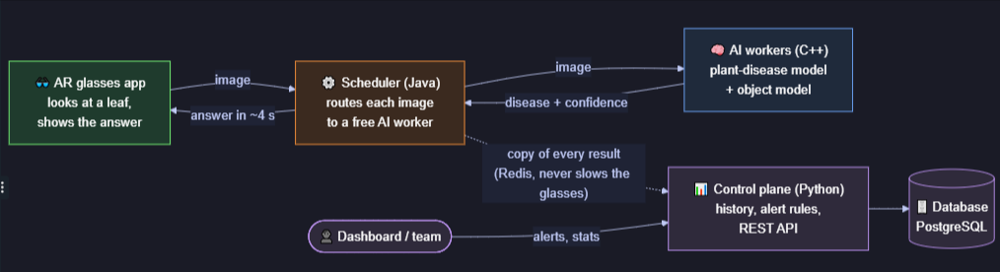
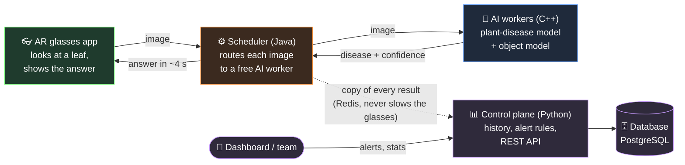

# AR Plant Inspector - V1

## 1. What V1 is

**V1** is a working prototype that lets a person wearing AR glasses look at a corn, tomato or potato leaf and see, within a few seconds, whether the leaf is diseased and which disease it is.

The glasses do not analyse anything themselves. They send what the camera sees to a server, where an AI model recognises the disease and sends the answer back as a small message in the corner of the view. Every answer is also saved on the server, so a supervisor can later see which diseases were found, where and when, and be alerted when something serious shows up.

## 2. System architecture

**How to read it:** follow one leaf from left to right. The glasses send an image to the scheduler, which hands it to a free AI worker; the answer goes back the same way to the glasses. The dotted line is a copy of every result, sent in the background to the control plane, which stores it in the database and raises alerts for the team.

**The key design idea:** the glasses only wait for the AI, never for storage or alerts, so saving results never slows the wearer down.

Diagram source (Mermaid) - edit here, then re-export the image from https://mermaid.live

## 3. The services

| Service | How it works | Built with | Status |
|---|---|---|---|
| 👓 **Glasses app** | Detects "holding still" by comparing tiny thumbnails of consecutive frames; sends 2 frames and votes. One gRPC stream that repairs itself and drops stale frames instead of queueing them. | Android (Kotlin), gRPC | ✅ on the emulator · ⬛ on the real glasses |
| ⚙️ **Scheduler** | Routes each image by model name to the least-loaded worker; time limit per model (objects 300 ms, plant 3.5 s); retries on another worker if one fails; max 2 images in flight per glasses. | Java 21, gRPC | ✅ ~11 images/s in the current environment |
| 🧠 **AI workers** | Each runs one ONNX model on the CPU; registers with the scheduler by heartbeat every second; aborts an inference that is past its deadline. | C++, ONNX Runtime, OpenCV | ✅ plant model (31 classes) + object model (80) |
| 📊 **Control plane** | Reads results from a Redis Stream with a consumer group (nothing lost on restart); alert rules with threshold, minimum count and per-device cooldown; REST API. | Python, FastAPI, Redis | ✅ |
| 🗄️ **Database** | Tables for frames, detections, alerts and rules; schema managed by migrations. | PostgreSQL, Alembic | ✅ |
| 👤 **Dashboard / team** | Reads alerts and stats through the REST API; can acknowledge alerts. | REST API (browser) | 🟡 API ready · ⬛ dashboard screen |

✅ done · 🟡 partly done · ⬛ not done yet

## 4. Limitations and next steps

| Limitation | Why (today) | Next step | Needs |
|---|---|---|---|
| **Only 3 crops:** corn, tomato, potato | The current model is trained for these 3 crops only | **To detect more crops, receive a trained model for each new crop** and plug it in as an AI worker. The system already supports any number of models (routing by model name), so no redesign is needed. | **Trained models provided** in ONNX format, one per new crop, with its diseases + "healthy" |
| **~4 s per answer** | Current model: ~2 s per image on CPU, 2 images per check | Use the provided models in a fast format (**YOLOv8** class): a test run took **136 ms per leaf** in the current environment | Models delivered in that format |
| **Current environment is small** | i7, 4 cores, **8 GB RAM**, no GPU: ~2 pairs of glasses max | **Server:** CPU-only pilot **8 cores + 16 GB RAM**; with GPU **≥ 8 GB VRAM + 16–32 GB RAM** | Server or cloud machine (sizes are estimates) |
| **Not tested on real glasses** | Emulator only; glasses camera and OS unknown | Install and test on the glasses | The glasses + Wi-Fi |

What V1 recognises today:

| Crop | Diseases |
|---|---|
| Corn | gray leaf spot, common rust, leaf blight |
| Tomato | early blight, late blight, Septoria leaf spot, bacterial spot, leaf mold, mosaic virus, yellow leaf virus, spider mites, healthy |
| Potato | early blight, late blight, healthy |
