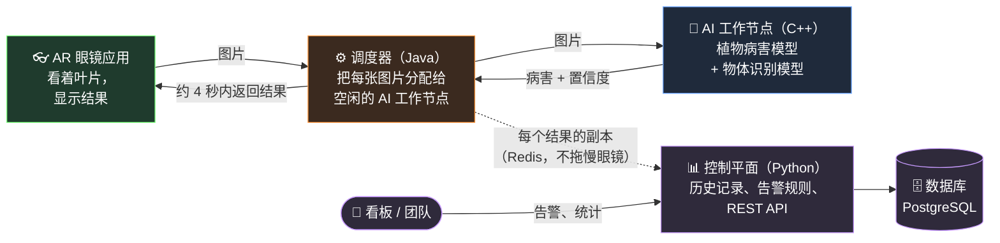

# AR 植物叶片检测 - V1

## 1. V1 是什么

**V1** 是一个可运行的原型：佩戴 AR 眼镜的人只需看着玉米、番茄或马铃薯的叶片，几秒钟内就能知道叶片是否患病，以及是哪种病害。

眼镜本身不做任何分析。它们把摄像头看到的画面发送到服务器，由服务器上的 AI 模型识别病害，再把结果以小提示的形式发回，显示在视野一角。每个结果也会保存在服务器上，方便主管日后查看在何时何地发现了哪些病害，并在出现严重情况时收到告警。

## 2. 系统架构

**如何阅读：** 从左到右跟随一片叶子。眼镜把图片发送给调度器，调度器把它交给一个空闲的 AI 工作节点；结果沿原路返回眼镜。虚线表示每个结果的副本，在后台发送到控制平面，由它存入数据库并为团队生成告警。

**关键设计思想：** 眼镜只等待 AI 的结果，从不等待存储或告警，因此保存结果永远不会拖慢佩戴者。

## 3. 服务

| 服务 | 工作原理 | 技术栈 | 状态 |
|---|---|---|---|
| 👓 **眼镜应用** | 通过比较连续画面的缩略图判断“保持不动”；发送 2 帧并投票。使用一条可自动修复的 gRPC 数据流，直接丢弃过时的画面，而不是排队等待。 | Android（Kotlin）、gRPC | ✅ 模拟器上 · ⬛ 真实眼镜上 |
| ⚙️ **调度器** | 按模型名称把每张图片分配给负载最低的工作节点；每个模型有时间上限（物体 300 毫秒，植物 3.5 秒）；某个节点失败时换另一个节点重试；每副眼镜最多同时处理 2 张图片。 | Java 21、gRPC | ✅ 当前环境约 11 张图片/秒 |
| 🧠 **AI 工作节点** | 每个节点在 CPU 上运行一个 ONNX 模型；每秒通过心跳向调度器注册；超过时限的推理会被中止。 | C++、ONNX Runtime、OpenCV | ✅ 植物模型（31 类）+ 物体模型（80 类） |
| 📊 **控制平面** | 通过消费者组读取 Redis Stream 中的结果（重启也不会丢失）；告警规则包含阈值、最少数量和按设备的冷却时间；提供 REST API。 | Python、FastAPI、Redis | ✅ |
| 🗄️ **数据库** | 存放帧、检测结果、告警和规则的数据表；数据库结构由迁移脚本管理。 | PostgreSQL、Alembic | ✅ |
| 👤 **看板 / 团队** | 通过 REST API 读取告警和统计数据；可以确认告警。 | REST API（浏览器） | 🟡 API 已就绪 · ⬛ 看板界面 |

✅ 已完成 · 🟡 部分完成 · ⬛ 尚未完成

## 4. 局限与下一步

| 局限 | 原因（目前） | 下一步 | 所需条件 |
|---|---|---|---|
| **仅支持 3 种作物：** 玉米、番茄、马铃薯 | 当前模型只针对这 3 种作物训练 | **如需识别更多作物，为每种新作物获取一个训练好的模型**，并作为 AI 工作节点接入。系统已支持任意数量的模型（按模型名称路由），无需重新设计。 | **提供训练好的模型**（ONNX 格式），每种新作物一个，包含其病害类别 +“健康” |
| **每次结果约 4 秒** | 当前模型在 CPU 上每张图片约 2 秒，每次检查 2 张图片 | 使用快速格式（**YOLOv8** 类）的模型：测试中，当前环境下每片叶子仅需 **136 毫秒** | 以该格式交付的模型 |
| **当前环境规模较小** | i7、4 核、**8 GB 内存**、无 GPU：最多约 2 副眼镜 | **服务器：** 纯 CPU 试点 **8 核 + 16 GB 内存**；配 GPU 时 **≥ 8 GB 显存 + 16–32 GB 内存** | 服务器或云主机（配置为估算值） |
| **尚未在真实眼镜上测试** | 仅在模拟器上运行；眼镜的摄像头和操作系统情况未知 | 在眼镜上安装并测试 | 眼镜 + Wi-Fi |

V1 目前可识别：

| 作物 | 病害 |
|---|---|
| 玉米 | 灰斑病、锈病、大斑病 |
| 番茄 | 早疫病、晚疫病、斑枯病、细菌性斑点病、叶霉病、花叶病毒病、黄化曲叶病毒病、二斑叶螨、健康 |
| 马铃薯 | 早疫病、晚疫病、健康 |
